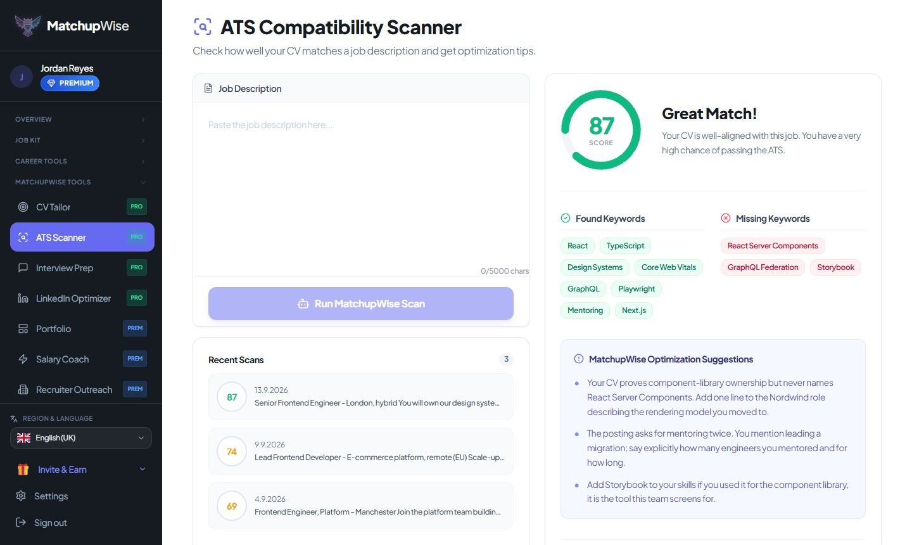
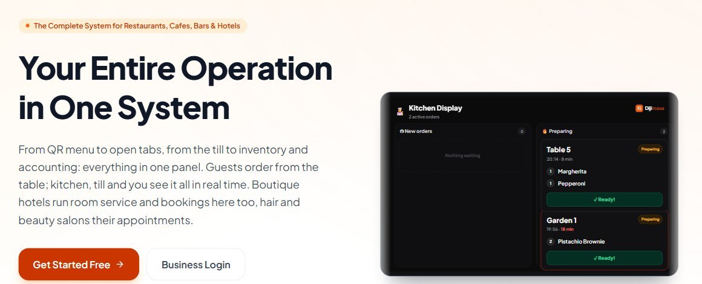

# Efe Cem Bardakoglu

**AI engineer in Germany. I build software that people use and pay for, from the first line of code to the app store listing.**

I have taken two products from idea to production on my own: a career app on the web and the App Store, and a restaurant and hotel management system. That means product design, backend, frontend, mobile, AI, payments, servers, SEO and the support emails, all of it.

---

## MatchupWise · AI career coach

Helps job seekers get from a CV to interviews: it scores a CV against a real job ad, rewrites it for that ad, writes the cover letter, runs mock interviews and maps out a career path.

- **Live** on [the web](https://matchupwise.com) and the [App Store](https://apps.apple.com/de/app/matchupwise-ai-career-coach/id6771545628), rated 5 stars, with paying subscribers
- **25 languages**, about 17,000 search-optimised pages generated from one codebase
- **AI layer:** my own agent runtime with evaluation harnesses, several LLM providers with fallback, job ranking against the candidate's profile
- **Under the hood:** FastAPI, PostgreSQL, Redis, Next.js, Capacitor for the native app, Apple in-app purchases, push notifications, CI/CD to a Linux server I run

## Dijimasa · operations software for restaurants and hotels

One system for a hospitality business: guests order from a QR code at the table, the kitchen sees it on a screen, staff run the till, stock and accounting from one panel. Hotels add bookings and room service, salons their appointments.

- **In production** at its first restaurant customer
- Turkish, English and German, with country-specific tax and invoicing rules
- Cloud receipt printing, multiple branches, an AI assistant inside the guest menu

---

## Open source

| Project | What it shows |
|---|---|
| **[agentloop](https://github.com/Efecem07/agentloop)** | How I build AI agents: one readable loop, every step traced, and evals that say whether the agent actually works. Extracted from the MatchupWise runtime. |
| **[ragloop](https://github.com/Efecem07/ragloop)** | Search for AI (keyword + semantic, fused) with the measurement attached. On the public SciFact benchmark its keyword search matches the published reference, and the numbers show when mixing in keyword search helps and when it does not. No dependencies. |
| **[ue5-mcp-server](https://github.com/Efecem07/ue5-mcp-server)** | Lets an AI agent drive the Unreal Engine 5 editor: 46 tools to build, inspect and play-test a game level. |

## How I work

- **Measure before claiming.** If a change is supposed to help, there is a number before and after it.
- **Ship, then watch.** I read the logs, the search data and the support inbox, and fix what real users hit.
- **Write it down.** Commits and code comments explain why, so the next person (or me in six months) can pick it up.

## Tools

Python · FastAPI · SQLAlchemy · PostgreSQL · Redis · TypeScript · Next.js · React · Tailwind · Capacitor
LLM APIs (OpenAI, Gemini, Groq, open models) · agents · RAG · evaluation
Docker · GitHub Actions · nginx · Linux · n8n

## Contact

[LinkedIn](https://www.linkedin.com/in/efecembardakoglu) · bardakogluefecem@gmail.com · Turkish, English, German

Name also written Efe Cem Bardakoğlu.
